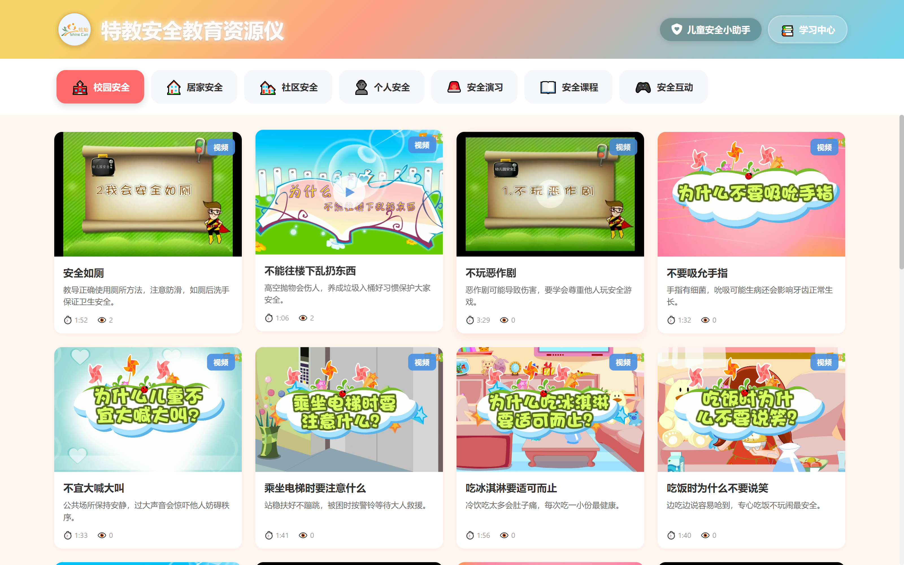
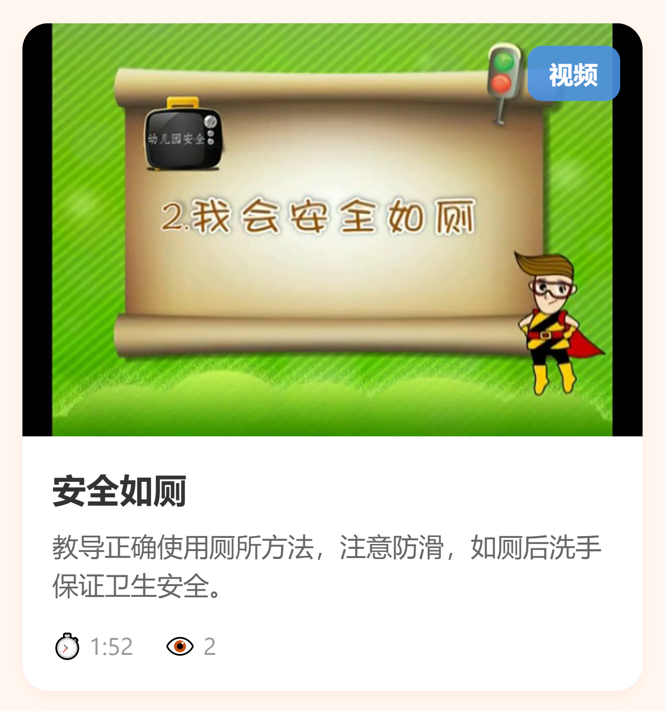
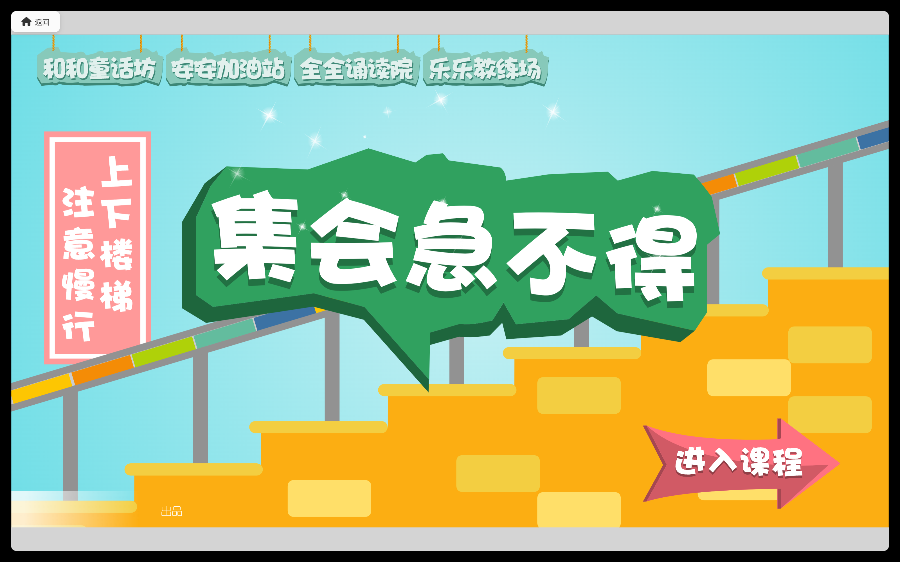
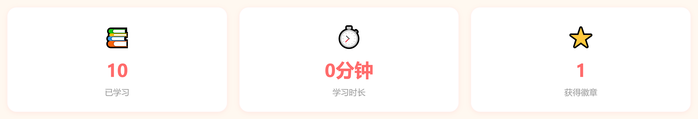
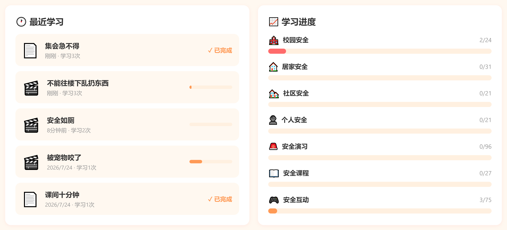
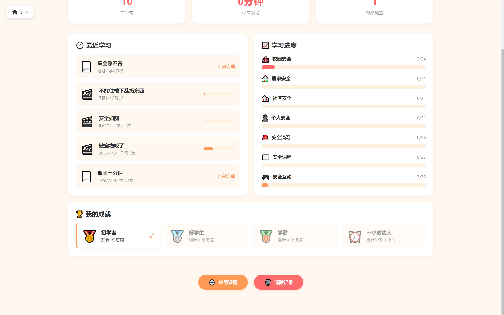
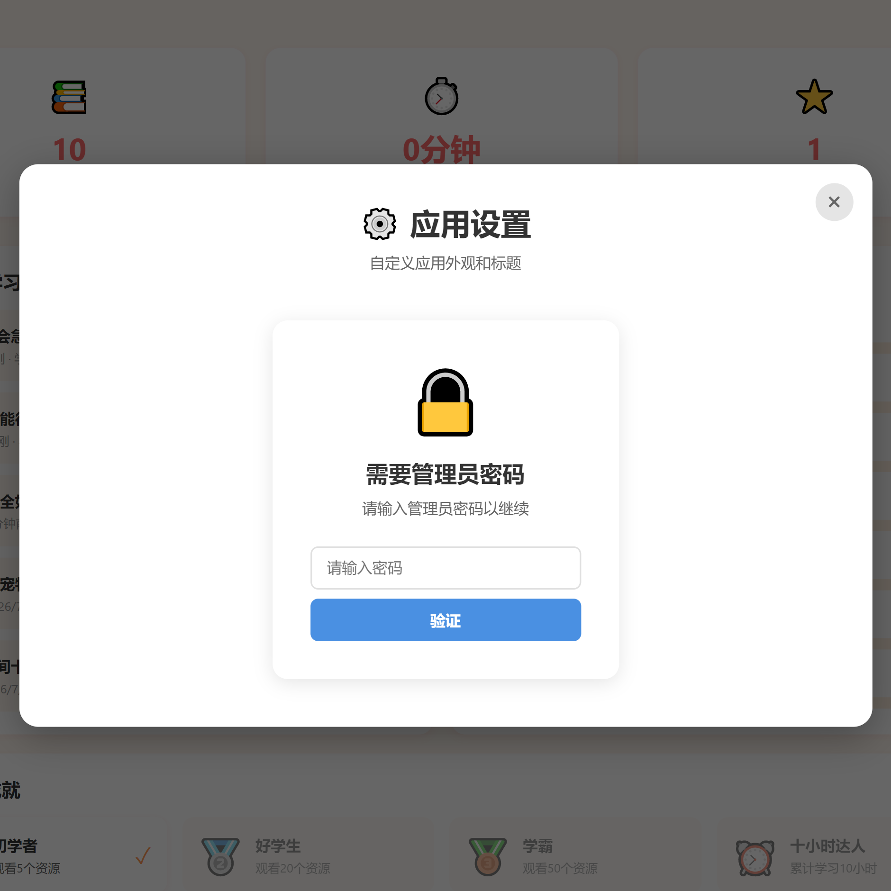
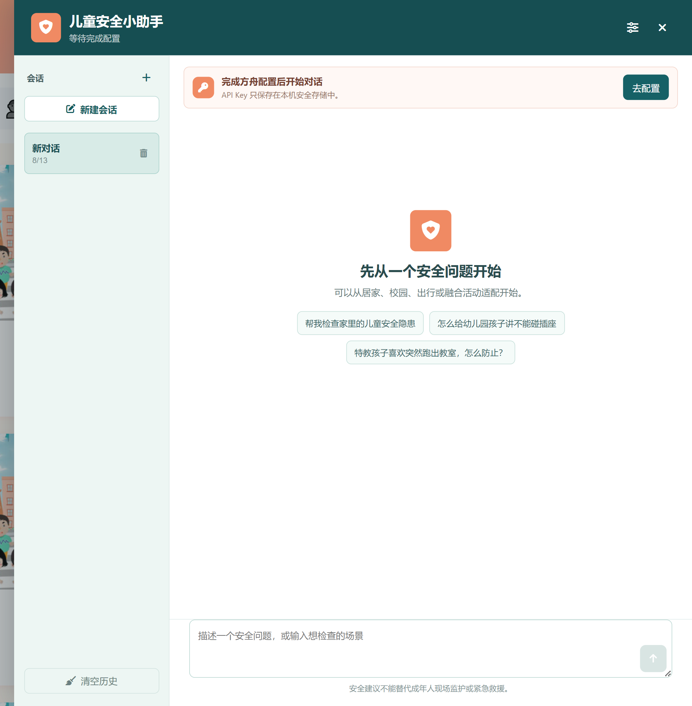

# 特教安全教育资源仪 · 用户操作手册

> 适用版本：1.0.3
> 适用对象：学校教师、家长等日常使用者（无需任何电脑专业知识）
> 软件激活由安装方负责，手册不涉及激活/许可相关内容

---

## 目录

1. [软件简介](#1-软件简介)
2. [启动与主界面](#2-启动与主界面)
3. [浏览与播放学习资源](#3-浏览与播放学习资源)
4. [学习中心](#4-学习中心)
5. [应用设置（需管理员）](#5-应用设置需管理员)
6. [儿童安全小助手](#6-儿童安全小助手)
7. [常见问题](#7-常见问题)
8. [附录](#8-附录)

---

## 1. 软件简介

**特教安全教育资源仪**是一款安装在电脑上的安全教育软件，专门为特殊教育学校设计，主要用于安全知识教学。软件包含：

- **295 个学习资源**：213 个安全教育视频 + 82 个 H5 互动课件（可点击操作的网页式课件）；
- **7 大安全分类**：校园安全、居家安全、社区安全、个人安全、安全演习、安全课程、安全互动；
- **儿童安全小助手**：内置的 AI 智能问答助手，可以回答儿童安全教育相关问题；
- **学习记录**：自动记录每次学习情况（观看次数、学习时长、学习进度），方便老师掌握学生（或孩子）的学习情况。

**提示**：所有资源都存放在电脑本地，无需网络也能播放视频和课件（仅"儿童安全小助手"需要联网）。

<!-- 截图：软件主界面全貌 -->

---

## 2. 启动与主界面

### 2.1 启动软件

1. 双击电脑桌面上的 **"特教安全教育资源仪"** 图标；
2. 等待片刻，软件即打开主界面。

> 提示：如启动时出现激活相关提示，请联系学校管理员（安装方）处理。

### 2.2 主界面组成

主界面从上到下分为三个部分：

| 区域 | 说明 |
|---|---|
| **顶部标题栏** | 左侧为学校 Logo 和应用标题（标题带柔和的"呼吸"光晕特效，若系统开启了"减少动态效果"，光晕会自动静止）；右侧为 **「儿童安全小助手」** 和 **「学习中心」** 两个按钮 |
| **分类导航栏** | 7 个安全分类按钮，点击即可切换资源列表 |
| **资源列表区** | 显示当前分类下的所有学习资源卡片 |

<!-- 截图：顶部标题栏（含标题、两个按钮） -->

### 2.3 七大分类

| 分类 | 图标 | 资源数量 |
|---|---|---|
| 校园安全 | 🏫 | 24 |
| 居家安全 | 🏠 | 31 |
| 社区安全 | 🏘️ | 21 |
| 个人安全 | 👤 | 21 |
| 安全演习 | 🚨 | 96 |
| 安全课程 | 📖 | 27 |
| 安全互动 | 🎮 | 75 |

点击任一分类按钮，下方资源列表即切换为该分类的内容；切换分类后再次返回时，软件会记住你上次浏览到的位置。

---

## 3. 浏览与播放学习资源

### 3.1 认识资源卡片

每个资源以卡片形式展示，卡片上包含：

- **封面图**：资源封面缩略图；
- **类型标识**：右上角角标，蓝色「视频」表示教学视频，绿色「H5」表示互动课件；
- **标题与简介**：资源名称和一句话内容介绍；
- **时长**：⏱️ 视频时长（仅视频显示）；
- **观看次数**：👁️ 该资源累计被学习的次数。

<!-- 截图：资源卡片特写（标注各元素） -->

### 3.2 播放视频

1. 点击视频资源卡片，进入播放页面（自动开始播放）；
2. 播放时可在画面下方控制条上进行操作：
   - ▶ 播放 / ⏸ 暂停；
   - 拖动进度条快进 / 快退；
   - 🔊 调节音量；
   - 倍速播放（0.5 倍 ~ 2 倍）；
   - ⛶ 全屏显示；
3. 视频播放期间，**观看进度会自动保存**；下次在"学习中心"里可以看到进度记录。

> 说明：每次打开一个资源，该资源的"观看次数"自动加 1；观看时间超过 3 秒才会计入学习时长。

<!-- 截图：视频播放页面 -->

### 3.3 使用 H5 互动课件

1. 点击带绿色「H5」角标的资源卡片，进入课件页面；
2. 课件直接在窗口内打开，画面上的按钮、选项都可以**直接用鼠标点击操作**，与网页一样；
3. 在课件内完成的互动内容（如点选、拖拽、答题）会实时生效。

<!-- 截图：H5 课件页面 -->

### 3.4 返回资源列表

- 播放页左上角有 **「返回」** 按钮，点击即回到资源列表；
- 返回后列表位置保持不变，可以继续浏览。

---

## 4. 学习中心

点击顶部标题栏右侧的 **「学习中心」** 按钮（📚）进入。学习中心集中展示学习情况，共五个部分：

### 4.1 顶部统计（三张卡片）

| 卡片 | 含义 |
|---|---|
| 📚 已学习 | 累计学习（打开资源）的总次数 |
| ⏱️ 学习时长 | 累计有效学习时间，自动换算为"X 小时 X 分" |
| ⭐ 获得徽章 | 已解锁的成就徽章数量 |

<!-- 截图：学习中心顶部统计卡片 -->

### 4.2 最近学习

- 按时间列出最近学过的资源（最多 5 条），显示**名称、学习时间、学习次数**；
- 视频资源下方有**进度条**，显示上次观看到的位置；
- H5 课件显示 **✓ 已完成** 标记；
- **点击任意一条记录，可直接再次播放该资源**。

### 4.3 学习进度

按七大分类分别统计：每一类**已学习资源数 / 该类资源总数**，并用进度条直观显示完成比例。

<!-- 截图：最近学习与学习进度区域 -->

### 4.4 成就徽章（🏆 我的成就）

持续学习可以解锁徽章，规则如下：

| 徽章 | 图标 | 解锁条件 |
|---|---|---|
| 初学者 | 🥇 | 累计观看 5 个资源 |
| 好学生 | 🥈 | 累计观看 20 个资源 |
| 学霸 | 🥉 | 累计观看 50 个资源 |
| 十小时达人 | ⏰ | 累计学习满 10 小时 |

此外，**完整学完某个分类**（该分类全部资源都学习过）还可以获得该分类的专属徽章。

<!-- 截图：成就徽章区域 -->

### 4.5 清除学习记录

> ⚠️ **请谨慎操作：此操作不可恢复！**

1. 点击学习中心底部的 **「🗑️ 清除记录」** 按钮；
2. 软件会弹出确认提示，说明将删除：所有观看历史、学习时长统计、已获得的成就徽章；
3. 确认后记录被清空（清除前请与管理员确认是否需要备份）。

### 4.6 打开应用设置

点击学习中心底部的 **「⚙️ 应用设置」** 按钮，可进入外观设置（详见[第 5 章](#5-应用设置需管理员)）。

---

## 5. 应用设置（需管理员）

> 本部分涉及软件外观调整，**需要管理员密码**（请联系学校管理员获取），一般由管理员或指定老师操作。
> 学校可能已对软件外观做过个性化配置（标题、Logo、配色），因此**不同学校看到的界面外观可能不同**，属正常现象。

### 5.1 进入设置

1. 进入「学习中心」；
2. 点击底部 **「⚙️ 应用设置」** 按钮；
3. 在弹出的窗口中输入**管理员密码**，点击「验证」。

<!-- 截图：管理员密码验证窗口 -->

### 5.2 可设置的项目

| 设置项 | 说明 |
|---|---|
| 📝 **应用标题** | 修改顶部显示的大标题文字；可调整字体大小（如 36px）和文字颜色（取色器选择） |
| 🖼️ **应用 Logo** | 点击「选择图片」上传学校 Logo（支持 PNG、JPG，**最大 1MB**）；点击「重置默认」恢复初始 Logo |
| 🎨 **顶部背景** | 修改顶部标题栏的背景渐变色，输入框内按 CSS 渐变格式填写（如 `linear-gradient(135deg, #667eea 0%, #764ba2 100%)`），下方有实时预览 |

### 5.3 保存与生效

1. 设置完成后点击 **「💾 保存设置」**；
2. 界面会自动刷新，新设置立即生效；
3. 如不想修改，点击「取消」关闭窗口即可。

> 提示：为避免误操作，建议修改前记录原来的标题、字号、颜色值，以便随时改回。

---

## 6. 儿童安全小助手

「儿童安全小助手」是软件内置的 AI 问答助手，可以回答儿童安全教育相关的问题，例如如何防止触电、如何组织安全演练、如何给特教儿童讲解安全知识等。

### 6.1 打开小助手

点击顶部标题栏右侧的 **「儿童安全小助手」** 按钮，右侧会滑出一个对话面板；点击面板右上角 ✕ 或面板外空白处可关闭。

<!-- 截图：小助手对话面板 -->

### 6.2 首次使用：配置（仅需一次）

> 小助手依赖网络连接火山方舟模型服务，**离线（无网络）环境下不可用**。

1. 打开小助手后，若提示 **"完成方舟配置后开始对话"**，点击 **「去配置」**（或点击面板右上角的配置按钮）；
2. 在弹出的配置窗口中：
   - **模型 / 推理接入点 ID**：一般已预置好（`deepseek-v4-flash-ga-260731`），**无需修改**；
   - **API Key**：填写学校提供的 API Key（输入时不显示明文）；
3. 点击 **「保存配置」** 完成配置。

> 🔒 **隐私说明**：API Key 只保存在这台电脑的安全存储中，不会显示给任何人，也不会上传到其他地方。配置完成后，即使重开软件也无需重复填写。
>
> 个别电脑若提示"当前系统安全存储不可用"，说明该电脑无法安全保存 API Key，此时会话仅保留在本次运行中，关闭软件后需重新配置——请直接联系学校管理员处理。

### 6.3 开始对话

- 新对话开始时，面板中央提供 3 个现成问题，点击即可提问：
  - "帮我检查家里的儿童安全隐患"
  - "怎么给幼儿园孩子讲不能碰插座"
  - "特教孩子喜欢突然跑出教室，怎么防止？"
- 也可以在底部输入框直接打字提问（输入框下方提示："描述一个安全问题，或输入想检查的场景"），按回车或点击 ➤ 按钮发送；
- 回答会逐字显示；生成过程中可点击 **「停止生成」** 中止。

### 6.4 会话管理

左侧栏为**会话列表**（每场对话为一个"会话"，自动保存）：

| 操作 | 方法 |
|---|---|
| 新建会话 | 点击左侧 **「＋」** 或 **「新建会话」** 按钮 |
| 切换会话 | 点击左侧列表中任意一个会话 |
| 删除会话 | 将鼠标移到会话上，点击出现的 🗑️ 图标（删除后无法恢复） |
| 清空全部历史 | 点击列表下方 **「清空历史」** 按钮（清空后无法恢复） |

### 6.5 修改提问与回答

- **编辑并重发**：对自己发送的最后一条消息，点击下方的「编辑并重发」，修改后重新发送；
- **重新生成**：对助手最后一条回答，点击「重新生成」，让助手重新回答一次。

### 6.6 ⚠️ 紧急情况（请务必阅读）

当输入的内容表明**正在发生**的紧急情况（如窒息、溺水、火灾、严重暴力、儿童失踪等）时，小助手会**立即**给出简短提示：拨打 **120（医疗急救）/ 119（火警）/ 110（报警）**，且该识别在本机完成、无需网络、无需等待。

> 🚨 **请牢记**：遇到紧急情况，**第一时间拨打相应急救电话**，或立即寻求周围成年人帮助。小助手**不提供现场急救或救援操作指导**，不能替代成年人现场监护和紧急救援。

### 6.7 小助手的能力边界

- 小助手只用于**安全教育知识问答**，不提供医学或心理诊断、不开药方、不提供身体约束等操作指导；
- 涉及特殊教育孩子时，建议**先描述孩子现在能做什么**（如"能听懂简单指令、会指认图片"），助手会据此给出更适合的适配建议；
- 助手不会索要儿童的姓名、证件号、详细住址、联系方式等隐私信息，请勿主动提供；
- 助手回答仅供参考，**不能替代专业医生、心理老师或特教教师的判断**。

---

## 7. 常见问题

### 7.1 点击资源后提示"视频加载失败"或无法播放

- 可能是资源文件缺失或软件安装不完整，请**重启软件**再试；
- 若仍无法播放，请联系学校管理员（安装方）检查安装是否完整。

### 7.2 H5 课件打开后白屏 / 无法显示

- H5 课件由软件内置的本地服务提供，出现白屏时**完全退出软件后重新打开**即可；
- 仍不行请联系安装方检查。

### 7.3 小助手提示"未配置 API Key"或"完成方舟配置后开始对话"

- 说明本机还未完成配置：点击 **「去配置」**，填写学校提供的 API Key 后保存；
- 注意：小助手**需要联网**才能工作，请确认电脑已连接网络。

### 7.4 小助手回答很慢或失败

- 多为网络问题，检查网络连接后重试（可点击「重新生成」）。

### 7.5 如何清空学习记录？

- 进入「学习中心」，点击底部 **「🗑️ 清除记录」** 按钮，按提示确认即可（**不可恢复，请谨慎**）。

### 7.6 标题的"呼吸"光晕效果能关掉吗？

- 在 Windows 系统设置中开启**"减少动态效果 / 关闭动画"**（系统"辅助功能"或"轻松使用"相关设置）后，标题光晕会自动停止，不影响使用。

### 7.7 学习记录和对话记录保存在哪里？会泄露吗？

- 所有学习记录、会话记录、API Key 均保存在**这台电脑本机**，不会自动上传到任何服务器；
- 小助手仅在对话时把**当前对话内容**发送给模型服务用于生成回答。

---

## 8. 附录

### 8.1 资源内容一览

软件共包含 **295 个学习资源**（213 个视频 + 82 个 H5 互动课件），分布在 7 大分类中：

| 分类 | 图标 | 数量 | 内容举例 |
|---|---|---|---|
| 校园安全 | 🏫 | 24 | 校园内活动、如厕、课间安全等 |
| 居家安全 | 🏠 | 31 | 居家防触电、防烫伤、防坠落等 |
| 社区安全 | 🏘️ | 21 | 出行、电梯、陌生人应对等 |
| 个人安全 | 👤 | 21 | 自我保护、卫生习惯等 |
| 安全演习 | 🚨 | 96 | 火灾、地震等应急演习 |
| 安全课程 | 📖 | 27 | 系统化的安全知识课程 |
| 安全互动 | 🎮 | 75 | 可操作的互动课件，寓教于乐 |

### 8.2 操作速查表

| 想做什么 | 怎么做 |
|---|---|
| 找某个分类的资源 | 主界面点分类导航按钮 |
| 播放视频 / 打开课件 | 点资源卡片 |
| 返回资源列表 | 播放页左上角「返回」 |
| 查看学习统计 | 顶栏「学习中心」 |
| 清除学习记录 | 学习中心 →「清除记录」 |
| 修改标题 / Logo / 背景色 | 学习中心 →「应用设置」（需管理员密码） |
| 问安全教育问题 | 顶栏「儿童安全小助手」 |
| 遇到紧急情况 | 立即拨打 120 / 119 / 110，不要依赖小助手 |

---

*本手册内容对应软件版本 1.0.3。如软件界面与手册略有差异，以实际界面为准。*
